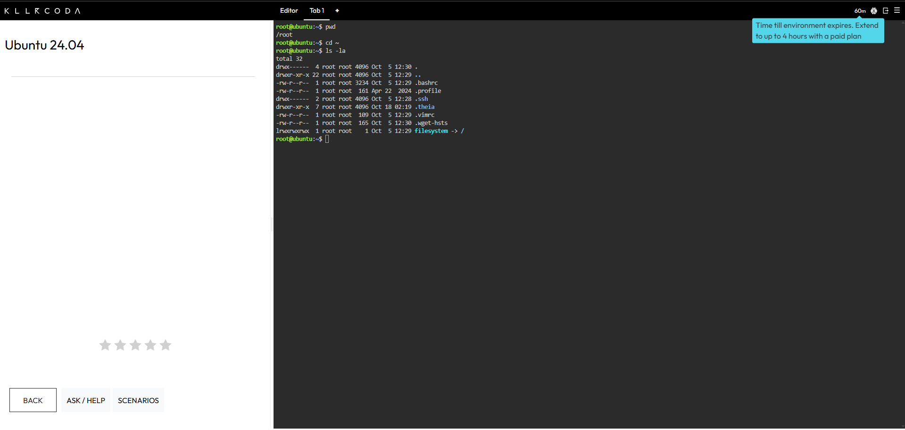
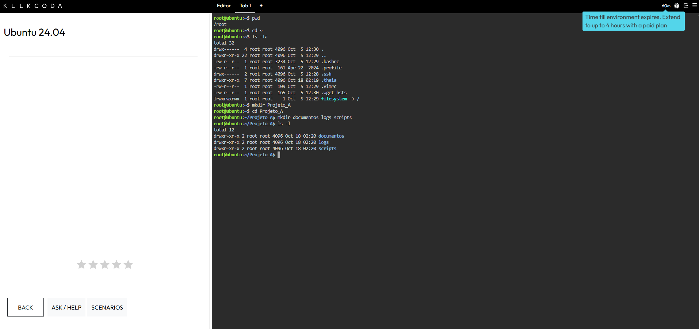
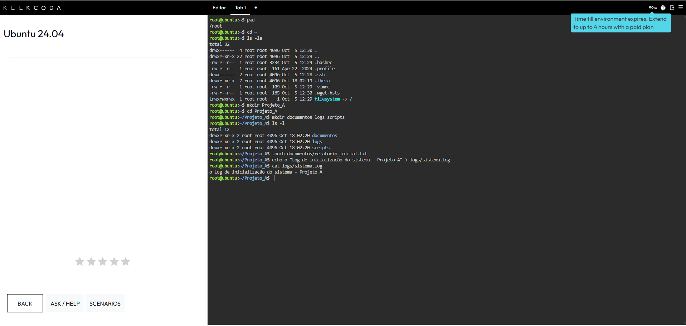
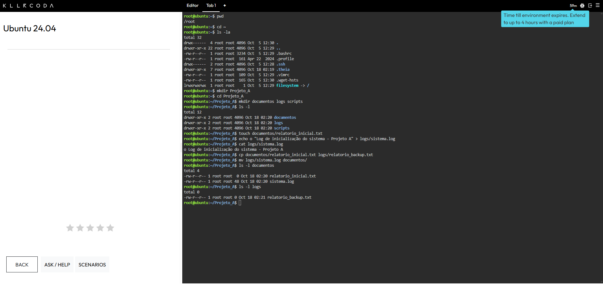
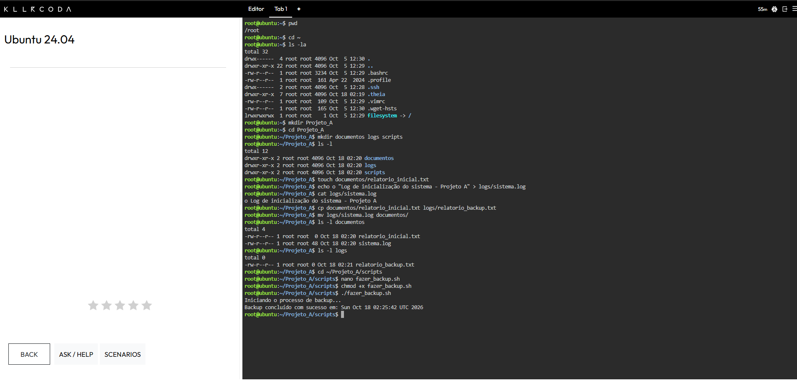
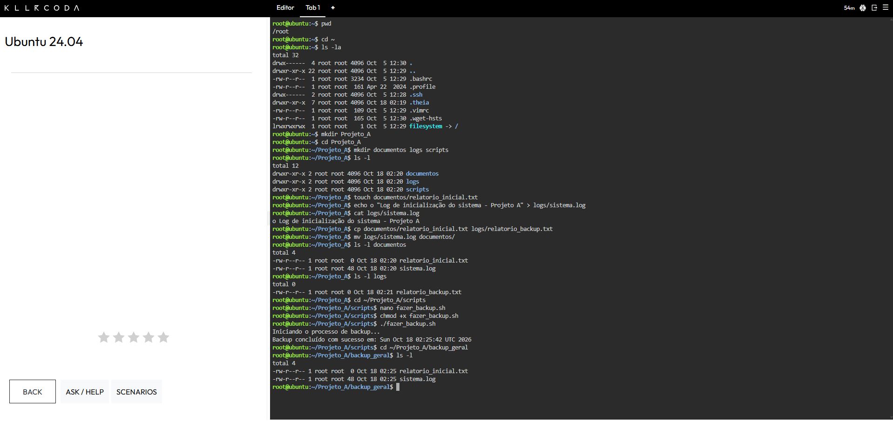

# Atividade-06 – Administração Linux (Killercoda / Ubuntu)

Exercício prático de gerenciamento de arquivos e diretórios no Linux, executado em uma máquina virtual remota Ubuntu no [Killercoda](https://killercoda.com/playgrounds/scenario/ubuntu).

- **Aluno:** _Giovanna Bandeira de Castro_
- **Disciplina:** _Sistemas Operacionais_
- **Ambiente:** Killercoda – Ubuntu Playground

---

## Etapa 1: Navegação e Inspeção do Ambiente

```bash
pwd
cd ~
ls -la
```

- `pwd`: mostra o diretório atual.
- `cd ~`: vai para o diretório pessoal (home).
- `ls -la`: lista tudo em formato detalhado, incluindo arquivos ocultos.

📸 **Evidência:**



---

## Etapa 2: Criação da Estrutura de Diretórios

```bash
mkdir Projeto_A
cd Projeto_A
mkdir documentos logs scripts
ls -l
```

- `mkdir` cria diretórios; aceita vários nomes de uma vez.

📸 **Evidência:**



---

## Etapa 3: Criação e Edição de Arquivos de Texto

```bash
touch documentos/relatorio_inicial.txt
echo "Log de inicialização do sistema - Projeto A" > logs/sistema.log
cat logs/sistema.log
```

- `touch` cria um arquivo vazio.
- `>` redireciona a saída do `echo` para um arquivo.
- `cat` exibe o conteúdo do arquivo.

📸 **Evidência:**



---

## Etapa 4: Cópia e Movimentação de Arquivos

```bash
cp documentos/relatorio_inicial.txt logs/relatorio_backup.txt
mv logs/sistema.log documentos/
ls -l documentos
ls -l logs
```

- `cp` duplica o arquivo (o original continua).
- `mv` move (ou renomeia) o arquivo.

📸 **Evidência:**



---

## Etapa 5: Criação e Execução de um Script Shell

```bash
cd ~/Projeto_A/scripts
nano fazer_backup.sh
```

Conteúdo do script `fazer_backup.sh`:

```bash
#!/bin/bash
# Script de automação de backup do Projeto_A

echo "Iniciando o processo de backup..."
mkdir -p ~/Projeto_A/backup_geral
cp -r ~/Projeto_A/documentos/* ~/Projeto_A/backup_geral/
echo "Backup concluído com sucesso em: $(date)"
```

Dar permissão de execução e executar:

```bash
chmod +x fazer_backup.sh
./fazer_backup.sh
```

- `#!/bin/bash` (shebang) define o interpretador do script.
- `chmod +x` adiciona permissão de execução.
- `./` indica que o executável está no diretório atual.

📸 **Evidência:**



---

## Etapa 6: Verificação do Backup

```bash
cd ~/Projeto_A/backup_geral
ls -l
```

**Resultado esperado:** o diretório `backup_geral` contém cópias de todos os arquivos de `documentos` (`relatorio_inicial.txt` e `sistema.log`).

📸 **Evidência:**



---

## Conclusão

Foram praticados navegação (`pwd`, `cd`, `ls`), criação de diretórios e arquivos (`mkdir`, `touch`, `echo`, `cat`), cópia e movimentação (`cp`, `mv`), permissões (`chmod`) e automação com Shell Script.
