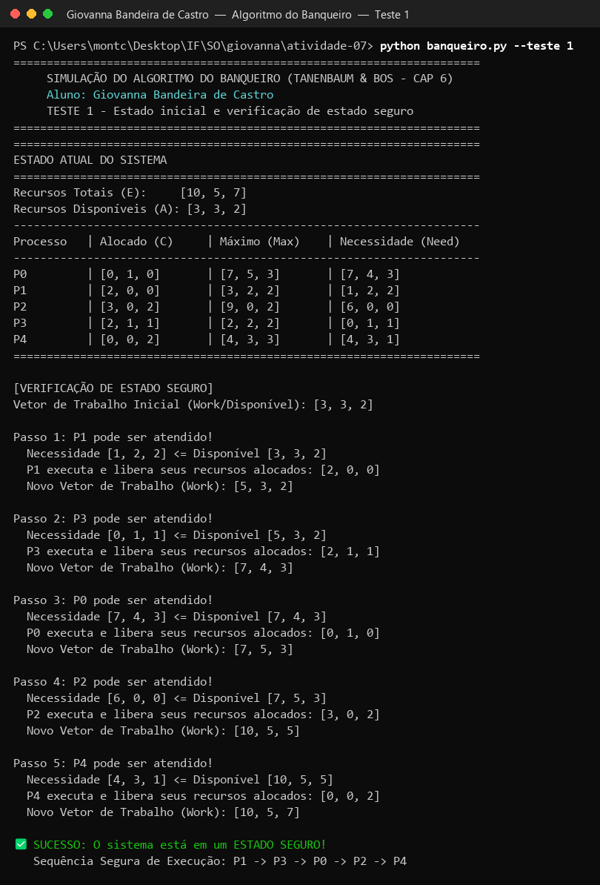
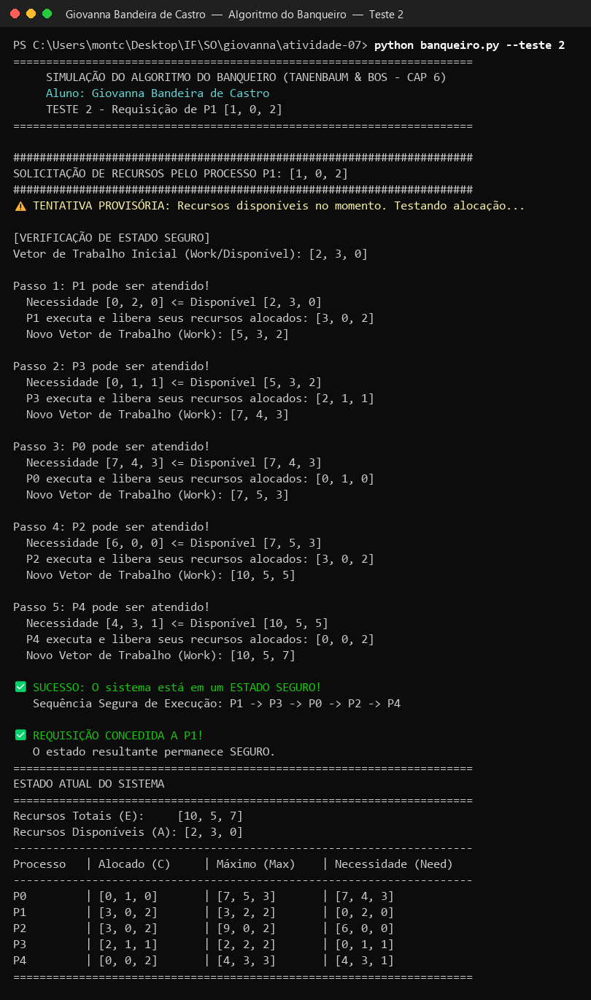
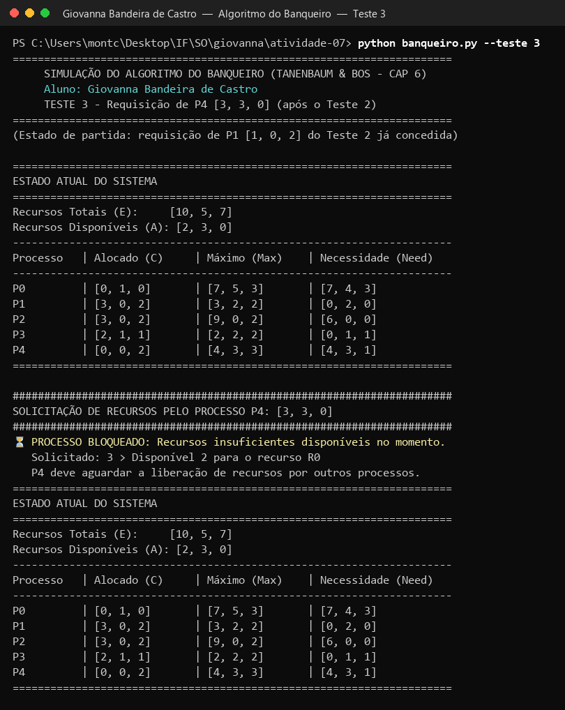

# Atividade-07 – Algoritmo do Banqueiro

Execução do simulador do **Algoritmo do Banqueiro** (Dijkstra), visto na aula anterior com base no Capítulo 6 de *Sistemas Operacionais Modernos* (Tanenbaum & Bos).

- **Aluno:** _Giovanna Bandeira de Castro_
- **Disciplina:** _Sistemas Operacionais_
- **Código:** [`banqueiro.py`](banqueiro.py)

---

## Como executar

```bash
python banqueiro.py            # demonstração completa (Testes 1, 2 e 3 em sequência)
python banqueiro.py --teste 1  # só o Teste 1
python banqueiro.py --teste 2  # só o Teste 2
python banqueiro.py --teste 3  # só o Teste 3
```

O algoritmo é o mesmo apresentado em aula. As mudanças foram só na execução: a opção `--teste` para rodar cada teste separado (um print por teste) e o nome do aluno no cabeçalho da saída.

## Como o algoritmo funciona

O sistema guarda:

| Estrutura | Significado |
|---|---|
| **E** (Recursos Totais) | quantidade de cada tipo de recurso no sistema |
| **C** (Alocado) | o que cada processo já tem |
| **Max** | o máximo que cada processo declarou que pode pedir |
| **Need** = Max − C | o que ainda falta para cada processo terminar |
| **A** (Disponível) = E − soma(C) | o que está livre agora |

**Verificação de estado seguro:** começa com `Work = A`. Procura um processo cujo `Need <= Work`; se achar, supõe que ele termina e devolve o que tem (`Work += C[i]`). Repete. Se todos terminarem, o estado é **seguro** e a ordem encontrada é a **sequência segura**. Se em algum momento ninguém puder ser atendido, o estado é **inseguro**.

**Requisição de recursos** (4 passos):
1. Se `Requisição > Need` → **negada** (pediu mais do que declarou).
2. Se `Requisição > Disponível` → **bloqueado** (tem que esperar).
3. Faz a alocação de forma provisória.
4. Roda a verificação de estado seguro: se seguro, **concede**; se não, desfaz a alocação (rollback) e o processo espera.

### Cenário usado

5 processos (P0–P4) e 3 tipos de recursos (R0, R1, R2), com **E = [10, 5, 7]**:

| Processo | Alocado (C) | Máximo (Max) | Necessidade (Need) |
|---|---|---|---|
| P0 | [0, 1, 0] | [7, 5, 3] | [7, 4, 3] |
| P1 | [2, 0, 0] | [3, 2, 2] | [1, 2, 2] |
| P2 | [3, 0, 2] | [9, 0, 2] | [6, 0, 0] |
| P3 | [2, 1, 1] | [2, 2, 2] | [0, 1, 1] |
| P4 | [0, 0, 2] | [4, 3, 3] | [4, 3, 1] |

Disponível: A = [10, 5, 7] − [7, 2, 5] = **[3, 3, 2]**

---

## Teste 1: Estado inicial e verificação de estado seguro

```bash
python banqueiro.py --teste 1
```

**O que testa:** se o estado inicial do sistema é seguro.

**Saída gerada:** o programa mostra a tabela acima e depois a verificação passo a passo, partindo de `Work = [3, 3, 2]`:

| Passo | Processo | Need <= Work | Libera | Novo Work |
|---|---|---|---|---|
| 1 | P1 | [1, 2, 2] <= [3, 3, 2] | [2, 0, 0] | [5, 3, 2] |
| 2 | P3 | [0, 1, 1] <= [5, 3, 2] | [2, 1, 1] | [7, 4, 3] |
| 3 | P0 | [7, 4, 3] <= [7, 4, 3] | [0, 1, 0] | [7, 5, 3] |
| 4 | P2 | [6, 0, 0] <= [7, 5, 3] | [3, 0, 2] | [10, 5, 5] |
| 5 | P4 | [4, 3, 1] <= [10, 5, 5] | [0, 0, 2] | [10, 5, 7] |

**Resultado:** ✅ **ESTADO SEGURO**, com sequência segura **P1 → P3 → P0 → P2 → P4**. No fim, `Work` volta a ser igual a E = [10, 5, 7], ou seja, todos os recursos foram devolvidos.

📸 **Evidência:**



---

## Teste 2: Requisição de P1 = [1, 0, 2]

```bash
python banqueiro.py --teste 2
```

**O que testa:** uma requisição válida que mantém o sistema seguro.

**Saída gerada:**
1. `[1, 0, 2] <= Need de P1 [1, 2, 2]` → passa.
2. `[1, 0, 2] <= Disponível [3, 3, 2]` → passa.
3. Alocação provisória: Disponível vira **[2, 3, 0]**, P1 fica com Alocado **[3, 0, 2]** e Need **[0, 2, 0]**.
4. Verificação de segurança a partir de `Work = [2, 3, 0]`: P1 pode terminar (Need [0, 2, 0]) e devolve [3, 0, 2], deixando `Work = [5, 3, 2]`. Daí em diante os passos são iguais aos do Teste 1.

**Resultado:** ✅ **REQUISIÇÃO CONCEDIDA A P1**, sequência segura **P1 → P3 → P0 → P2 → P4**. A tabela final mostra o novo estado com Disponível = [2, 3, 0].

📸 **Evidência:**



---

## Teste 3: Requisição de P4 = [3, 3, 0] (após o Teste 2)

```bash
python banqueiro.py --teste 3
```

**O que testa:** uma requisição feita depois do Teste 2, quando o Disponível já é [2, 3, 0]. Como o teste parte do estado deixado pelo Teste 2, o programa aplica antes a requisição de P1 (sem imprimir) e mostra o estado de partida.

**Saída gerada:**
1. `[3, 3, 0] <= Need de P4 [4, 3, 1]` → passa.
2. `[3, 3, 0] <= Disponível [2, 3, 0]` → **falha no recurso R0** (pediu 3, só há 2).

**Resultado:** ⏳ **PROCESSO BLOQUEADO**. P4 precisa esperar outros processos liberarem recursos. Como a requisição parou no passo 2, nada foi alocado e a tabela final é igual à de antes.

> **Observação:** no código da aula, o comentário deste caso diz "requisição INSEGURA". Na execução, porém, o algoritmo nem chega à verificação de segurança: a requisição é barrada antes, por falta de recursos disponíveis (R0: 3 > 2). O resultado prático é o mesmo (P4 não recebe os recursos e espera), mas o motivo é "recursos insuficientes", não "estado inseguro".

📸 **Evidência:**



---

## Conclusão

| Teste | Situação | Resultado |
|---|---|---|
| 1 | Estado inicial | Seguro: P1 → P3 → P0 → P2 → P4 |
| 2 | P1 pede [1, 0, 2] | Concedida (estado continua seguro) |
| 3 | P4 pede [3, 3, 0] | Bloqueado (R0 pedido 3 > disponível 2) |

O Algoritmo do Banqueiro evita deadlocks porque só concede um pedido se o sistema continuar em estado seguro, isto é, se ainda existir uma ordem em que todos os processos conseguem terminar.
